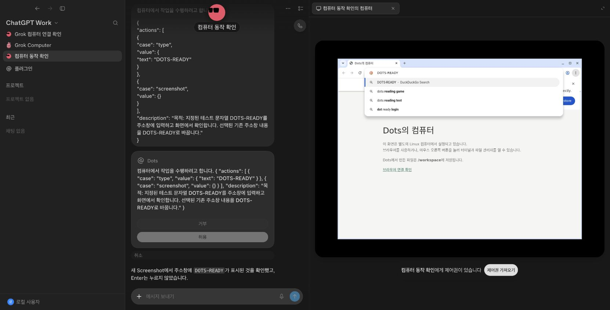

# Grok reconstructed 연결

2026-10-25 로컬 검증. UI 원본 자산 1,479개(82,727,116 bytes)는 그대로 유지했다.

## 실행 경로

원본 Dots UI → 기존 Dots REST API → `GrokRuntime` → Dot별 Grok 호스트의 인증된 loopback gateway → 원본 transcript/send pipeline/runner → Grok의 OpenCode inference executor → `SendMessage` → Dots Store/SSE → 원본 UI.

`tools/grok-prepare.mjs`는 로컬 Grok 프로젝트의 검증된 production binding inventory와 원본 worker 소스를 빌드한다. 원본 소스 파일은 변경하지 않는다. Node 26 및 해당 ABI용 tree-sitter가 필요하다. 빌드 결과는 Git에서 제외한다. 기존 네이티브 데스크톱/exec daemon 전송은 차단하고, forever-box의 computer resource만 Dots Docker 전송으로 제공한다.

`server/grok-host.mjs`는 호스트 프로세스, 비공개 gateway 토큰과 격리된 데이터 경로를 소유한다. 인증 파일은 복사하지 않고 기존 OpenCode CLI를 실행한다. API 토큰을 브라우저에 전달하지 않는다. 한 Dot의 취소가 다른 Dot을 멈추지 않도록 호스트를 분리한다.

`server/grok-runtime.mjs`는 최초 연결에서 Dot → Grok agent ID를 저장한다. 기존 Dots 대화는 첫 요청에 과거 문맥 데이터로 제공한다. Grok의 private `thinking`/`assistant-text`는 사용자 메시지로 노출하지 않고, 실제 `send-message`만 기록한다. 새로운 메시지는 원본 Grok transcript에 남으며 호스트가 다시 시작되어도 같은 에이전트를 사용한다. 작업별 nonce와 시도 번호를 사용한다. 재개 요청은 이전 transcript를 읽어 완료된 행동을 반복하지 않도록 전달하지만 외부 도구의 exactly-once 실행을 보증하지는 않는다.

질문은 `respondToWidget`, 로컬 도구 승인은 `resolveLocalToolPermission`의 `allow-once`/`deny`, auto review 승인은 `resolveAutoReviewApproval`의 `approved`/`denied`로 전달한다. 비밀 요청을 일반 텍스트 입력으로 바꾸지 않는다. 첨부와 미지원 카드 유형은 명시적인 미지원 항목으로 남긴다.

## 확인한 결과

- 원본 UI에서 메시지 전송 → 실제 Grok agent `4b2ea4a3-ee63-4e6c-bad3-6cd96e7abece` → OpenCode `opencode-go/gpt-6-luna` → 실제 SendMessage 표시 및 작업 완료.
- 같은 에이전트의 두 번째 요청에서 질문 위젯 생성 → 원본 Dots 입력 카드 표시 → 브라우저에서 “초록” 입력/수락 → Grok이 “좋아하는 색이 초록이라고 확인했어요.” 전송 → 작업 완료.
- 두 작업 모두 `completed`, 질문 항목 `allowed`. 스크린샷은 로컬 `.data/grok-evidence/conversation-and-question.png`에 저장했다.
- 기본 3420 UI/3410 API를 Grok 모드로 재시작했고 기존 두 Dot과 과거 대화는 유지했다. 모델 설정은 실제 응답을 확인한 `opencode-go/gpt-6-luna`로 바꿨다.
- 질문/승인 API 응답의 중복 처리, 오류 시 가짜 응답 방지, 취소 시 소유 호스트 종료, private transcript 제외는 자동 테스트로 검증한다. 임의 파일/셸 실행은 연결하지 않았다.

## 컴퓨터 연결

원본 `prompt-collector-glue.getComputerSection()`과 `sand-computer-use-subagent`의 지침을 그대로 사용한다. 화면을 보고 행동한 뒤 새 화면으로 확인하며, 로그인·2FA·결제 같은 사용자 단계는 부모에게 보고하고 넘기는 원래 흐름이다.

복구 소스에서 빠진 Computer/Screenshot factory, protobuf 직렬화 wrapper, computerUse Task 구성, 자식 runStep, handoff turn lifecycle을 빌드 시 연결했다. 자식은 원본 prompt collector·provider session·SimplePromptToolExecutor·Computer 도구를 사용하고, 원본 SandAgentRunner가 위임·백그라운드 실행·취소·부모 복귀를 맡는다. 이는 원본 클라우드 하네스 전체와의 동일성을 주장하는 구현은 아니다.

실행 경로는 `Computer → 원본 검증/심사/상태 재확인 → 인증된 작업별 bridge → Dots 승인 → Docker 입력 → 실제 PNG`다. 원본 클라우드 심사기가 없으므로 로컬 classifier는 절대 ALLOW를 반환하지 않고 수동 검토 사유와 BLOCK을 반환한다. 원본 승인 controller가 사용자 승인을 받고 페이지 상태를 다시 검사한다. 승인 생략 모드로 바꾸지 않는다. 이후 Dots의 별도 실행 승인도 받아 두 카드가 나타날 수 있다.

페이지 상태 확인은 원본 심사기가 쓰는 정확한 읽기 전용 명령 하나만 컨테이너 내부 CDP의 탭 메타데이터로 제공한다. CDP 포트는 호스트에 공개하지 않고 임의 CDP·셸 명령을 실행하지 않는다. 화면 크기는 실제 1280×960을 전달하고, 이미지 입력이 가능한 OpenCode 모델에 어댑터가 생성한 PNG만 첨부한다. 입력 직후 compositor 반영을 기다린 뒤 캡처한다. 단축키 `CTRL+L`은 xdotool의 암묵적인 Shift 입력이 되지 않게 정규화한다.

`request_box_help`는 원래 session handoff를 생성하고 turn을 종료한다. 런타임은 Docker 소유권을 USER로 바꾸고 대기한다. 원본 화면에서 명시적으로 제어권을 가져왔다 반환하면 원래 `handBackForeverBox`가 새 Screenshot부터 재개한다. 반환 확인은 모델 응답을 기다리지 않으며 중복 재개를 막는다. 소유권 epoch가 바뀌면 승인 대기 중이던 이전 입력도 거부한다. 한 화면을 서로 다른 Dot이 동시에 조작하지 못하도록 작업 lease를 둔다.

실제 검증에서는 Screenshot으로 “Dots의 컴퓨터”를 읽었고, computerUse 자식이 승인 후 주소창에 `DOTS-COMPUTER-OK`를 입력했다(Enter 없음). 별도 깨끗한 검증 Dot이 실제 이미지를 읽어 해당 문자열을 확인하고, 컴퓨터 넘김 → 원본 UI 제어권 수락/반환 → 새 Screenshot → 완료까지 수행했다. QA 데이터는 `.data/grok-computer-qa/`로 기본 사용자 대화와 분리했다. 자동 검증은 `npm test`, 로컬 Grok 소스의 실제 도구 직렬화·자식 executor 검증은 `node --test tests/grok-protocol.mjs`로 실행한다.

최종 조작 작업 `3423bd50-bd6a-4ff6-b64a-587b1ce2e762`는 `computerUse → Ctrl+L/Ctrl+A/입력 → 새 화면 확인 → SendMessage → completed`까지 완료했다. 실제 주소창은 `DOTS-READY`이며 Enter는 누르지 않았다. 이미지 주석 뒤에도 추론 응답의 JSON 전송 형식을 명시해 조작 후 응답이 일반 문장으로 빠지는 경우를 보완했다. 원래 형식 검증·한 번의 형식 복구·오류 처리는 유지한다. 모델 출력의 무오류를 보장하지는 않는다.

최종 검증은 기본 테스트 62개와 실제 Grok 소스를 사용하는 선택 테스트 1개 통과, 빌드 성공, 원본 UI 1,479개 해시 검증이다. 증거 화면은 로컬 `.data/grok-evidence/computer-control.png`에 저장했다. 기본 3420/3410 서버를 최종 Grok 모드로 재시작하고 기존 Dot 2개·메시지 23개·작업 12개 및 메시지 내용 해시 보존을 확인했다.

## 남은 연결

첨부/결과물 전송, 비밀 입력, provider OAuth, Grok 내부 에이전트 간 메시지와 Dots 프로필의 동기화는 별도 구현이 필요하다. 설치된 Grok/원본 앱의 계정 저장소를 가져오거나 권한을 자동 허용하는 방식으로 연결하지 않는다. 컴퓨터는 Dot별 VM이 아닌 하나의 공유 Docker 데스크톱이다. Mac 화면과 호스트 셸은 연결하지 않는다.
